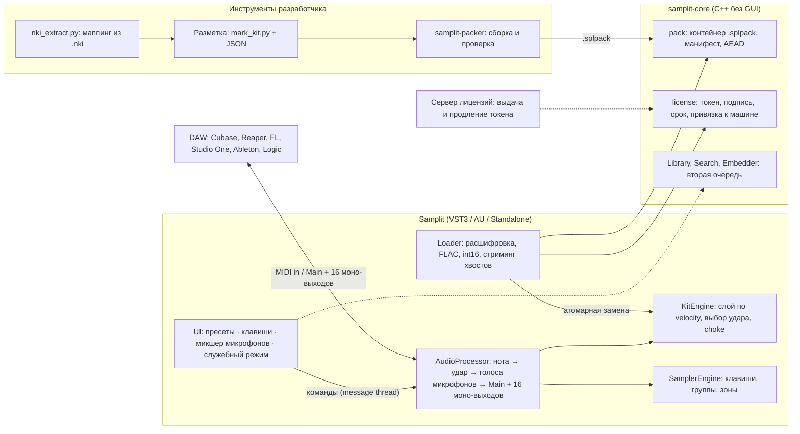
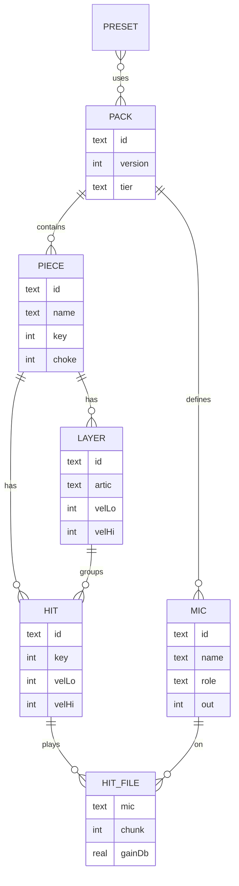

# Samplit — карточка проекта

Мультимикрофонный барабанный инструмент и сэмплер с мульти-аутом. VST3 · AU · Standalone.
Этот файл заменяет артефакт «Samplit» (раньше жил на claude.ai). Задачи — снимок из общей базы артефакта на 23.10.2026; дальше трекаем здесь или в issues.

---

# Обзор

## Что делаем

Готовый барабанный инструмент для DAW на живой записи Studio600. Установка записана на 15 микрофонов, один удар звучит как набор файлов по микрофонам, и каждый микрофон уходит на свою дорожку микшера. Продюсер выбирает пресет, играет по клавишам и получает «как будто записанную установку» с живым выбором удара по velocity. Маппинг и сэмплы он не видит: они лежат в защищённых пакетах. Тот же движок умеет работать как универсальный сэмплер (клавиши, группы, зоны), на нём мы разбираем и размечаем библиотеку. Умный поиск по личной коллекции остаётся второй очередью.

### Для кого

Продюсеры и битмейкеры, которые пишут в Cubase и других DAW и хотят живую барабанную установку с раздельными микрофонами без ручной настройки выходов, как в Kontakt. Библиотека принадлежит студии Studio600 (Пачевский Д.Е.).

### Три кита продукта

- **Играть:** клавиши, готовые пресеты, слой и удар по velocity, режим «Живой».
- **Разводить:** микрофон = выход, Main и 16 моно-выходов, Cubase как основная DAW.
- **Защищать:** пакеты base, mid, large и дополнения, шифрование, лицензия по токену.

### Ключевые решения

- **Стек:** C++ / JUCE, CMake
- **Форматы:** VST3, AU (macOS), Standalone
- **ОС:** Windows сейчас, macOS обязательно позже
- **Данные:** пакеты .splpack (FLAC + XChaCha20-Poly1305), маппинг из .nki
- **Выходы:** Main стерео + 16 моно
- **Лицензия:** подписанный токен на 7 или 30 дней, сервер только выдаёт и продлевает
- **Права:** аудио принадлежит Пачевскому Д.Е. и Studio600, код только по разрешению автора ( LICENSE )

### Где сейчас

На 24.10 готов сэмплер (клавиши, группы, зоны, выход группы, 50 тестов, pluginval 5), разобрана библиотека (30 396 файлов, 12,3 ГБ), из .nki снят полный маппинг (2 361 удар, 21 группа-микрофон). Проект пересмотрен, подробности в `docs/project-revision.md`.

Готово 24.10: 16 моно-выходов, модель и движок ударов, формат пакета со сборщиком, токен лицензии с сервером, разметка библиотеки (119 автотестов, pluginval 5). Ближайшее: загрузка пакетов в плагине, пресеты и микшер микрофонов, первые пакеты, проверка в Cubase.

ТЗ для кафедры пишет Пачевский, согласовать и подписать до 16.11

## Что изменилось 24.10

| Тема | Было | Стало |
| --- | --- | --- |
| Продукт | Менеджер личной коллекции с умным поиском и пэдами | Готовый мультимикрофонный барабанный инструмент с пресетами |
| Единица звука | Сэмпл на пэде | Удар: набор файлов по микрофонам с одной клавиши и velocity |
| Velocity | Громкость | Выбор слоя и удара, громкость не меняется |
| Выходы | Main + 8 стерео, пэд N на выход N | Main + 16 моно, микрофон = выход |
| Данные | Индекс папок в SQLite | Зашифрованные сжатые пакеты с маппингом |
| Лицензия | Нет | Токен со сроком, офлайн-проверка, продление через сервер |
| Поиск, теги, ONNX | Ядро проекта | Вторая очередь |

## Открытые вопросы

| Вопрос | Почему важно | Статус |
| --- | --- | --- |
| Остаётся ли в ТЗ ВКР интеллектуальный поиск и в каком виде? | ТЗ пишет Пачевский, срок 16.11. От этого зависит содержание второй очереди и название работы | [согласовать] |
| Группы `-D` в .nki и клавиши малого A0, A#0, B0, тарелок C7–G#7 | В руководстве не описаны, нужны для полноты маппинга | [спросить Пачевского] |
| Условия распространения: кто выпускает токены, сроки, форма раздачи пакетов | Права на аудио у Пачевского и Studio600 | [согласовать] |
| Порог обрезки тихого хвоста (по умолчанию −60 дБ) | Стриминг в v1 не нужен: после обрезки пресет около 1,3 ГБ. Порог проверить на слух на тарелках | [проверить на слух] |
| Два повреждённых файла в библиотеке | TOMS-Pearl-Masters/A2/0-397.wav и 0-398.wav состоят из нулей, на других микрофонах целы. Запросить у Пачевского заново | [запросить] |
| Лицензия разбора .nki | tools/nki\_extract.py это порт ConvertWithMoss (LGPL-3.0), в плагин не входит. Нужно решить, как держать файл в репозитории и оговорить в `LICENSE` | [решить] |
| Ветка допфункций (extras) | Нота и тональность, BPM, кит по запросу, закрывание хэта под темп. Не блокирует основную работу | [отдельная ветка] |
| Mac для AU и Logic | Ни у кого из команды Mac нет. Сборку под macOS предусматриваем в коде, вопрос железа решим позже | [решить позже] |
| Поиск по-русски | Модели «текст↔звук» (CLAP) обучены на английском. Нужен перевод запроса или мультиязычный энкодер (вторая очередь) | [вторая очередь] |
| Лицензии компонентов | JUCE подтверждено автором проекта. В записке перечислить остальные: VST3 SDK, Monocypher, SQLite, Catch2 | [JUCE: ок] |

---

# ТЗ

## Техническое задание (рабочее, для команды)

Наше внутреннее ТЗ, пересмотрено 24.10: основной продукт теперь мультимикрофонный барабанный инструмент, а личная коллекция и поиск стали второй очередью. Официальное ТЗ ВКР составляет научный руководитель. Приоритеты: [MVP] нужно к первому показу, [v1] обязательно к защите, [v2] вторая очередь, делаем, если успеваем.

### Функциональные требования

| ID | Требование | Приоритет |
| --- | --- | --- |
| F1.1 | Пресет: выбор готового набора барабанов, микрофонов и пакетов; пользователь не видит маппинг | [v1] |
| F1.2 | Клавиатура: клавиша это барабан (раскладка библиотеки, C3 = 60), подсветка звучащих клавиш, названия барабанов | [MVP] |
| F2.1 | Удар: по ноте и velocity выбирается слой и один удар; все микрофоны этого удара стартуют вместе с одного сэмпла | [v1] |
| F2.2 | Режим «как в Kontakt»: velocity выбирает точный удар по окнам библиотеки | [v1] |
| F2.3 | Режим «Живой»: слой по velocity (в щели между окнами берётся ближайший), удар внутри слоя случайный, без повтора подряд, разброс по соседним слоям задаётся в пресете | [v1] |
| F2.4 | Громкость от velocity для библиотеки Studio600 не применяется; громкость зоны (gainDb) применяется на микрофон | [v1] |
| F2.5 | Choke-группы: хэт глушит хэт (быстрый фейд) | [v1] |
| F3.1 | Мульти-аут: Main (стерео-микс) и 16 моно-выходов, микрофон = выход; выход, не включённый в DAW, играет в Main | [v1] |
| F3.2 | Микшер микрофонов: уровень, панорама, Solo/Mute, выбор выхода; сохраняется в проекте DAW | [v1] |
| F3.3 | Подсказка и статус «выход выключен в DAW, звук идёт в Main», инструкция по Cubase, Reaper и остальным | [v1] |
| F4.1 | Пакеты .splpack: манифест, блоки FLAC; несколько пакетов складываются (base, mid, large, дополнения), пакеты ставятся в папку Packs | [v1] |
| F4.2 | Шифрование блоков (XChaCha20-Poly1305), чтение любого файла без распаковки всего пакета, подмена байта обнаруживается | [v1] |
| F4.3 | Загрузка пресета в фоне с прогрессом; int16 в памяти; тихие хвосты обрезаются при сборке пакета (стриминг с диска отложен до v2) | [v1] |
| F5.1 | Лицензия: подписанный токен со сроком (7 или 30 дней), проверка офлайн, привязка к машине | [v1] |
| F5.2 | Продление токена в фоне, звук не блокируется; без действующего токена играет демо | [v1] |
| F6.1 | Универсальный сэмплер (служебный режим): клавиши, группы, зоны с диапазонами velocity, режимы «все», «по кругу», «случайно», выход группы, drag&drop файлов и папок | [MVP] |
| F6.2 | Инструменты разработчика: выгрузка маппинга из .nki, ручная разметка, сборка и проверка пакетов | [v1] |
| F7.1 | Состояние плагина (пресет, микрофоны, выходы, настройки) сохраняется в проекте DAW и восстанавливается при открытии | [v1] |
| F8.1 | Браузер: список файлов папки, прослушивание, waveform, drag&drop на клавишу (служебный режим) | [MVP] |
| F8.2 | Индексация папок пользователя в SQLite, пересканирование только изменённых файлов | [v2] |
| F8.3 | Анализ и автотеги: дескрипторы, тип и характер звука; свои теги, избранное, коллекции | [v2] |
| F8.4 | Поиск по имени, тегам и описанию на русском и английском, «найти похожие», кит по запросу | [v2] |
| X1 | Допфункция: высота тона, BPM и тональность лупов; закрывание хэта под темп трека | [extras] |

### Нефункциональные требования

| ID | Требование | Как проверяем |
| --- | --- | --- |
| N1 | Работа без сети по токену: ничего не качается при запуске, сеть нужна только для получения и продления токена | Демо с выключенным Wi-Fi на токене, выпущенном заранее |
| N2 | Аудиопоток без аллокаций, блокировок и файлового ввода-вывода (подгрузка хвостов не блокирует) | Код-ревью, нет щелчков при 64 сэмплах буфера |
| N3 | Память: пресет загружается в фоне; библиотека 12,3 ГБ, но пресет «вся установка + малый» после обрезки хвостов около 1,3 ГБ int16 | Замер пикового потребления на пресете «вся установка» |
| N4 | Защита: сэмплы нельзя достать из пакета без плагина; честная модель угроз описана в записке | Тесты подмены и неверного ключа, разбор в записке |
| N5 | Работает в Cubase 15 (основная), Reaper, FL Studio, Studio One, Ableton Live; AU в Logic | Чек-лист по каждой DAW |
| N6 | Проходит pluginval; не зависит от версии msvcp140.dll на компьютере пользователя | Прогон pluginval на каждой сборке, запуск на чистой машине |
| N7 | Выбор удара соответствует velocity, удар не повторяется подряд, микрофоны одного удара синхронны | Автотесты, прослушивание |
| N8 | Поиск по 50 000 сэмплов не дольше 200 мс; качество измеряется (precision@10) (вторая очередь) | Замер на тестовой базе, размеченный набор запросов |

### Вне рамок проекта

- Облачная синхронизация, магазин сэмплов, аккаунты.
- Скачивание пакетов из самого плагина: пакеты раздаются отдельно.
- Эффекты и модуляция внутри плагина: эффекты остаются в DAW, для этого и нужен мульти-аут.
- Генерация звука нейросетью.

---

# Архитектура

## Архитектура

Ядро без GUI отделено от плагина. Плагин тонкий: движок ударов и сэмплер плюс интерфейс. Всё тяжёлое (расшифровка пакетов, декодирование FLAC, стриминг хвостов, продление лицензии) идёт в фоновых потоках, аудиопоток только играет готовые буферы.



### Модули

| Модуль | Ответственность | Ключевые классы JUCE / библиотеки |
| --- | --- | --- |
| **KitEngine** | Барабан, слой, удар; удар выбирается один раз, все микрофоны удара стартуют вместе; режимы «как в Kontakt» и «Живой»; choke | свои голоса, `AudioBuffer`, атомарная передача кита |
| **SamplerEngine** | Универсальный сэмплер: клавиши, группы, зоны, выход группы. Служебный режим и «свои сэмплы» | свои голоса, `MidiBuffer` |
| **Pack** (core) | Контейнер .splpack: манифест, блоки FLAC с шифрованием XChaCha20-Poly1305, чтение любого блока без распаковки всего | Monocypher, `FlacAudioFormat`, `juce::JSON` |
| **License** (core) | Токен с подписью Ed25519, срок, привязка к машине, защита от перевода часов, продление в фоне | Monocypher, `juce::URL` |
| **Loader** | Фоновая загрузка пакетов пресета, расшифровка, декодирование, int16 в памяти (стриминг хвостов отложен до v2) | `ThreadPool` |
| **Packer, разметка** (tools) | Выгрузка маппинга из .nki, ручная разметка, сборка и проверка пакетов | Python, C++ на core/pack |
| **UI** | Пресеты, клавиши с названиями барабанов, микшер микрофонов, статус лицензии; служебный режим (группы и зоны) скрыт в релизе | `Component`, `DragAndDropContainer` |
| **Library, Scanner, Analyzer, Tagger, Embedder, Search** | Вторая очередь: индекс личной коллекции, автотеги, поиск по описанию | SQLite, ONNX Runtime, CLAP |

### Потоки

- **Audio thread**: только воспроизведение. Готовые буферы и кит передаются через атомарную замену ссылки, без локов.
- **Message thread**: UI, команды пользователя.
- **Пул фоновых потоков**: расшифровка и декодирование пакетов, подгрузка хвостов, сканирование (вторая очередь).
- **Поток лицензии**: проверка токена и продление, звук никогда не ждёт сети.

### Модель данных пакета



Индекс личной коллекции (вторая очередь) остаётся прежним: таблицы samples, tags, embeddings в core/Library.

### Мульти-аут в DAW

В JUCE это выходные шины в `BusesProperties` плюс `isBusesLayoutSupported`. Теперь Main стерео и 16 моно-выходов: микрофон библиотеки моно, и каждый получает свою моно-дорожку. Каждая DAW включает дополнительные выходы по-своему, порядок записываем в инструкцию.

| DAW | Как включаются выходы | Статус |
| --- | --- | --- |
| Cubase 15 (основная) | Instrument Track или Rack, Activate Outputs, выходы появляются каналами MixConsole | [проверить] |
| Reaper | Проверено 22.10 на стерео-выходах: Reaper предлагает создать дорожки под выходы. Повторить для моно | [повторить] |
| FL Studio | Настройки обёртки плагина, раздел про выходы, привязка к трекам микшера | [разобраться] |
| Studio One | Раскрытие выходов инструмента в микшере | [разобраться] |
| Ableton Live | Аудиодорожки со входом с выходов плагина | [проверить] |
| Logic (AU) | Инструмент вставляется как Multi-Output, дополнительные каналы добавляются в микшере | [нужен Mac] |

### Структура репозитория

```
samplit/
├─ CMakeLists.txt
├─ libs/JUCE            (git submodule)
├─ core/                samplit-core: pack, license, Library (и вторая очередь: Scanner, Search)
├─ plugin/              AudioProcessor, KitEngine, SamplerEngine, Editor (UI)
├─ tools/               nki_extract.py, mark_kit.py, packer, license_server, прототипы поиска
├─ tests/               юнит-тесты ядра и плагина
├─ docs/                архитектура, пересмотр проекта, пакеты, библиотека, инструкции по DAW
├─ brand/               брендбук и фирменный стиль
└─ sample_library/      библиотека Studio600 (не в git)
```

---

# Истории и эпики

## Пользовательские истории

От лица продюсера. Каждая история привязана к эпику, задачи на вкладке «Задачи» привязаны к тем же эпикам. Истории про личную коллекцию и поиск (US1, US3, US4, US5, US9 – US13) теперь вторая очередь.

| ID | Как продюсер, я хочу… | …чтобы | Эпик | Очередь |
| --- | --- | --- | --- | --- |
| US14 | выбрать готовый пресет барабанов и сразу играть | не разбираться в маппинге, зонах и файлах | E13 | [основная] |
| US15 | играть обычными MIDI-нотами и velocity | установка звучала естественно, а velocity не надо подбирать под слой | E10 | [основная] |
| US16 | получить каждый микрофон на своей дорожке микшера | сводить установку как настоящую: кик, снейр, оверхеды, комнаты отдельно | E5 | [основная] |
| US17 | чтобы повторяющиеся удары звучали по-разному | игра была живой, без «пулемёта» одного и того же файла | E10 | [основная] |
| US18 | поставить только нужные пакеты (базовый, расширенный, тарелки) | не держать на диске всю библиотеку | E11 | [основная] |
| US19 | пользоваться без постоянного интернета | плагин работал по токену и продлевал его раз в неделю или месяц | E12 | [основная] |
| US20 | как правообладатель, чтобы сэмплы нельзя было просто вытащить из пакета | библиотека не расходилась по сети файлами | E12 | [основная] |
| US6 | разложить сэмплы по клавишам и играть их с MIDI-клавиатуры | сразу накидать бит (универсальный сэмплер) | E4 | [основная] |
| US7 | чтобы каждая группа или микрофон шёл на свою дорожку микшера | обрабатывать кик, снейр и 808 отдельно своими эффектами | E5 | [основная] |
| US8 | открыть проект и увидеть всё на местах | не собирать пресет заново | E4 | [основная] |
| US2 | быстро прослушивать сэмплы прямо в DAW | не лазить по проводнику и не перетаскивать файлы вслепую | E3 | [основная] |
| US1 | указать папки с сэмплами | плагин сам нашёл и проиндексировал всё, что у меня есть | E2 | [вторая] |
| US3 | описать звук словами | найти «тот самый» сэмпл, даже не зная, как называется файл | E7 | [вторая] |
| US4 | фильтровать по типу и характеру | сразу смотреть только киков или только тёмные пэды | E6 | [вторая] |
| US5 | найти похожие на понравившийся сэмпл | подобрать замену или слой | E7 | [вторая] |
| US9 | перетащить сэмпл из плагина на дорожку | использовать его как аудиоклип | E3 | [вторая] |
| US10 | работать без интернета и подписок | не зависеть от сервисов (для личной коллекции; про лицензию на пакеты см. US19) | E2 | [вторая] |
| US11 | видеть ноту и BPM сэмпла (допфункция) | подобрать звук под трек без подбора на слух | E6 | [вторая] |
| US12 | отмечать избранное и собирать коллекции | быстро возвращаться к любимым звукам | E2 | [вторая] |
| US13 | одной кнопкой собрать кит в нужном настроении | быстро начать трек с цельного набора | E7 | [вторая] |

## Эпики

| ID | Эпик | Содержание | Истории |
| --- | --- | --- | --- |

| ID | Эпик | Содержание | Истории |
| --- | --- | --- | --- |
| E1 | **Каркас и сборка** | CMake + JUCE, VST3/AU/Standalone, сборка Win и macOS, pluginval, статический рантайм | все |
| E2 | **Библиотека пользователя и индексация** | Папки, сканер, SQLite, инкремент, избранное, коллекции. Вторая очередь | US1, US10, US12 |
| E3 | **Браузер и прослушивание** | Список, превью, waveform, drag&drop | US2, US9 |
| E4 | **Сэмплер: клавиши, группы, зоны** | Диапазоны клавиш и velocity, режимы группы, выход группы, состояние в проекте | US6, US8 |
| E5 | **Мульти-аут и DAW** | Main + 16 моно-выходов, микрофон = выход, проверка в Cubase и других DAW, инструкции | US7, US16 |
| E6 | **Анализ и автотеги** | Дескрипторы, нота, BPM, теги типа и характера. Вторая очередь | US4, US11 |
| E7 | **Умный поиск** | Поиск по описанию RU/EN, похожие, кит по запросу. Вторая очередь | US3, US5, US13 |
| E8 | **UX и дизайн** | Сценарии, макеты, визуальный стиль, удобство | все |
| E9 | **Данные и качество** | Тестовый набор сэмплов, разметка, метрики | US3, US4 |
| E10 | **Движок ударов** | Барабан, слой, удар, все микрофоны удара вместе, режимы «как в Kontakt» и «Живой», choke, загрузка пакетов | US15, US17 |
| E11 | **Пакеты и маппинг** | Разбор библиотеки, маппинг из .nki, разметка, формат .splpack, сборщик, уровни пакетов | US18 |
| E12 | **Лицензия и защита** | Токен, сервер выдачи и продления, привязка к машине, шифрование пакетов | US19, US20 |
| E13 | **Пресеты и интерфейс инструмента** | Выбор пресета, микшер микрофонов, служебный режим | US14 |
| E0 | **Организация** | Показы, ТЗ, обзор рынка, документация, права | — |

---

# Задачи

Статусы: `[ ]` не начата, `[~]` в работе, `[x]` готово. Снимок на 23.10.2026.

### КТ0 · показ 23.10 (8/11)

| | ID | Эпик | Задача | Кто | Заметка |
| --- | --- | --- | --- | --- | --- |
| [x] | t01 | E0 | Завести репозиторий и карточку проекта | — | Репозиторий samplit, эта страница |
| [x] | t02 | E1 | Поставить JUCE, CMake и C++ в Visual Studio | Артем | JUCE 9.0.4 как submodule, CMake + Ninja + MSVC, сборка tools/build.ps1, пресеты для Visual Studio |
| [x] | t03 | E1 | Собрать пустой плагин (VST3 + Standalone) и открыть его в Reaper | Артем | VST3 и Standalone собираются, плагин открывается в Reaper |
| [x] | t04 | E2 | Выбор папки и рекурсивный список аудиофайлов (WAV, AIFF, FLAC) | Артем | Выбор папки, фоновый рекурсивный обход: WAV, AIFF, FLAC, OGG |
| [x] | t05 | E3 | Список сэмплов в интерфейсе и прослушивание по клику | Артем | Прослушивание по клику и стрелкам, отдельный голос прослушивания всегда в Main |
| [x] | t06 | E4 | 8 пэдов: назначить сэмпл на пэд, запуск кликом и MIDI-нотой | Артем | Перетаскивание из списка и проводника, Enter на свободный пэд, MIDI-ноты C1–G1, очистка правым кликом. 24.10: пэды заменены клавиатурой, группами и зонами (E4) |
| [x] | t07 | E5 | 8 стерео-выходов: пэд N звучит на выходе N | Артем | Main + 8 стерео-выходов, без включённых выходов всё в Main. Покрыто автотестами. 24.10: решено перейти на 16 моно-выходов, микрофон = выход |
| [x] | t08 | E5 | Показать мульти-аут в Reaper: 8 пэдов на 8 дорожках | Артем | Проверено 22.10: Reaper сам предлагает дорожки под 9 выходов, пэды звучат на своих дорожках. Инструкция docs/daw/reaper.md |
| [~] | t09 | E9 | Собрать тестовый набор сэмплов (50–100 файлов, свои, нарезанные в Cubase) | Кирилл | Собирается. Пока для проверки есть сгенерированные: python tools/make_test_samples.py (37 файлов). 24.10: получена библиотека Studio600 (30 396 файлов), для автотестов остаётся генерируемый набор |
| [~] | t10 | E0 | Подготовить сценарий демо на 3–5 минут и проверить без интернета | Артем | Сценарий готов: docs/demo-kt0.md. Осталось прогнать утром на ноутбуке без интернета |
| [ ] | t11 | E0 | Вопросы к Пачевскому: тональность, поиск по-русски, объём работы каждого | — | 24.10: библиотека и руководство получены. Осталось: остаётся ли поиск в ТЗ (см. отдельную задачу), группы -D, клавиши A0/A#0/B0 и тарелки C7-G#7 |

### Этап 1 · сэмплер и маппинг (16/23)

| | ID | Эпик | Задача | Кто | Заметка |
| --- | --- | --- | --- | --- | --- |
| [x] | t12 | E1 | Структура репозитория: core/ и plugin/, юнит-тесты ядра | Артем | core/ (без GUI) и plugin/, 35 автотестов Catch2, CI на GitHub Actions |
| [x] | t14 | E1 | Прогнать pluginval на сборках | Артем | pluginval строгость 5: SUCCESS |
| [x] | t15 | E2 | SQLite: схема БД, миграции, добавление и чтение сэмплов | Артем | core/Library: таблица samples, версия схемы в meta (миграций пока нет), WAL |
| [x] | t17 | E3 | Waveform выбранного сэмпла | Артем | Волна выбранного файла под списком |
| [ ] | t19 | E10 | Choke-группы: хэт глушит хэт | Артем | Пэды заменены группами и зонами. Choke входит в движок ударов (F2.5) |
| [x] | t20 | E4 | Сохранение состояния в проекте DAW (кит + роутинг) | Артем | Файлы на пэдах, настройки пэдов и папка браузера сохраняются в проекте. Роутинг хранит сама DAW |
| [ ] | t21 | E5 | Проверить мульти-аут в Cubase 15 (основная), затем FL Studio, Studio One, Ableton | — | По каждой DAW записать инструкцию. Выходы теперь моно: проверять после перехода на 16 моно-выходов |
| [x] | t22 | E5 | Назначение выхода группе вручную и режим «всё в Main» | — | Готово 24.10 для групп сэмплера: выход Main или Out 1-16, выключенный в DAW выход играет в Main, тесты. Для микрофонов библиотеки это будет в пресете и микшере |
| [ ] | t26 | E13 | Первые макеты интерфейса: пресеты, клавиши, микшер микрофонов | — | Ориентир: макет в брендбуке (раздел «Интерфейс»), обновлён 24.10 |
| [~] | t28 | E0 | Обзор рынка для записки: мультимикрофонные барабанные инструменты и менеджеры сэмплов | — | Страница обзора обновлена 24.10 (docs/market-analysis.md). Осталось: поставить демо и проверить пункты «не подтверждено» |
| [x] | t30 | E0 | LICENSE: аудио принадлежит Пачевскому Д.Е. и Studio600, код только по разрешению автора | Артем |  |
| [x] | t31 | E1 | Статический рантайм MSVC: падение Cubase на чужом компьютере | Артем | Дамп 23.10: на том компьютере msvcp140.dll 14.36, мы собирали STL 14.51 |
| [x] | t32 | E11 | Разбор библиотеки Studio600 и руководства: структура, раскладка по клавишам | Артем | docs/library-structure.md |
| [x] | t33 | E11 | Маппинг из .nki: выгрузка утилитой tools/nki_extract.py | Артем | 2 361 удар, 16 226 зон, 21 группа-микрофон. JSON в sample_library/mapping (не в git) |
| [x] | t34 | E4 | Сэмплер: клавиши, группы, зоны по velocity, выход группы, сохранение в проекте | Артем | 50 автотестов, pluginval уровень 5 |
| [x] | t35 | E0 | Пересмотр проекта: docs/project-revision.md, обновление карточки, брендбука и обзора рынка | Артем | 24.10 |
| [x] | t36 | E5 | 16 моно-выходов: микрофон = выход (вместо 8 стерео) | Артем | Готово 24.10: Main стерео + Out 1-16 моно, выключенный в DAW выход играет в Main. pluginval 5 SUCCESS |
| [x] | t37 | E10 | Модель Kit/Piece/Hit и движок: слой по velocity, удар без повтора, все микрофоны удара вместе, gain зоны | Артем | Готово 24.10: plugin/Kit*.h/.cpp, 30 тестов. Загрузчика пакетов в плагине ещё нет |
| [x] | t38 | E10 | Режимы выбора удара: «как в Kontakt» и «Живой» | Артем | Готово 24.10: оба режима, слой с pick=exact даёт точный удар, 256 голосов, кубическая интерполяция |
| [x] | t39 | E10 | Решение по стримингу хвостов тарелок | Артем | Решено 24.10 (docs/streaming-design.md): в v1 стриминг не нужен, тихий хвост обрезается при сборке пакета (-60 дБ), пресет около 1,3 ГБ int16. Порог проверить на слух |
| [ ] | t49 | E0 | Согласовать с Пачевским ТЗ ВКР: что с интеллектуальным поиском, права, раздача пакетов | — | Срок 16.11 |
| [ ] | t50 | E11 | Спросить Пачевского: группы -D, клавиши малого A0, A#0, B0 и тарелки C7-G#7 | — | Не описаны в руководстве |
| [ ] | t51 | E0 | Лицензия tools/nki_extract.py (порт ConvertWithMoss, LGPL-3.0): оформить в репозитории | — | Файл должен остаться под LGPL и быть отдельно оговорён в LICENSE |

### Этап 2 · пакеты и пресеты (2/5)

| | ID | Эпик | Задача | Кто | Заметка |
| --- | --- | --- | --- | --- | --- |
| [x] | t40 | E11 | Формат .splpack и сборщик samplit-packer (core/pack): FLAC, шифрование, тесты | Артем | Готово 24.10: core/pack, samplit-packer (build, verify, info), 22 теста. FLAC даёт около 2,7-3 раза, с обрезкой хвоста от 5 до 19 процентов от WAV |
| [x] | t41 | E11 | Разметка поверх выгрузки из .nki: барабаны, слои, микрофоны, выходы; пакеты ядро, хэт, райд, тарелки | Артем | Готово 24.10: tools/mark_kit.py, 8 пакетов, пресет studio600-default. Вопросы к Пачевскому собраны в отчёте и задаче про -D |
| [ ] | t45 | E11 | Загрузка пакетов в плагине: фоновая, int16 в памяти, прогресс | — | Зависит от стриминга и формата |
| [ ] | t46 | E13 | Пресеты: выбор пресета, уровни и выходы микрофонов | — | tools/presets/studio600-default.json |
| [ ] | t47 | E13 | Микшер микрофонов и служебный режим (скрыт в релизе) | — |  |

### Этап 3 · лицензия и защита (2/3)

| | ID | Эпик | Задача | Кто | Заметка |
| --- | --- | --- | --- | --- | --- |
| [x] | t42 | E12 | Токен лицензии: подпись Ed25519, срок, привязка к машине, проверка в ядре | Артем | Готово 24.10: core/license, 16 тестов. Нужно: боевой ключ подписи вместо тестового, отпечаток на macOS, подключение в плагин |
| [x] | t43 | E12 | Сервер лицензий (/activate, /renew, /revoke) и выпуск токена для защиты | Артем | Готово 24.10: tools/license_server (FastAPI + SQLite), admin.py, make_token.py, 20 тестов. Реальный HTTPS-запрос из плагина ещё не проверен |
| [ ] | t44 | E12 | Токен для защиты диплома: выпустить заранее и проверить без сети | — | Срок длинный, привязка к ноутбуку для демо |

### Этап 4 · продукт (0/2)

| | ID | Эпик | Задача | Кто | Заметка |
| --- | --- | --- | --- | --- | --- |
| [ ] | t13 | E1 | Сборка под macOS: VST3 + AU + Standalone | — | Нужен Mac, выяснить, у кого он есть |
| [ ] | t48 | E11 | Пакеты mid и large, дополнения (тарелки отдельно) | — |  |

### Этап 5 · поиск и релиз (0/8)

| | ID | Эпик | Задача | Кто | Заметка |
| --- | --- | --- | --- | --- | --- |
| [~] | t16 | E2 | Сканер с инкрементом (размер + дата), индексация в фоне с прогрессом | Артем | Инкрементный скан в ядре готов и покрыт тестами. Осталось: подключить к браузеру с прогрессом (вторая очередь после пересмотра 24.10) |
| [~] | t18 | E3 | Фильтры, сортировка и текстовый поиск по имени | Артем | Поиск по словам в имени и пути готов. Осталось: фильтры и сортировка (вторая очередь после пересмотра 24.10) |
| [ ] | t23 | E6 | Базовые дескрипторы: длительность, пик, RMS, атака, центроид, one-shot или луп | — | Сначала Python-прототип, затем C++ (вторая очередь после пересмотра 24.10) |
| [ ] | t24 | E7 | Прототип поиска на Python: CLAP + косинус по 200 сэмплам, запросы по-русски | — | Оценить, годится ли подход (вторая очередь после пересмотра 24.10) |
| [ ] | t25 | E7 | Выбрать способ перевода русских запросов (словарь или мультиязычный энкодер) | — | Вторая очередь после пересмотра 24.10 |
| [ ] | t27 | E9 | Расширить тестовый набор до 500+ и разметить 30 эталонных запросов | — | Нужно для замера качества поиска (вторая очередь после пересмотра 24.10) |
| [ ] | t29 | E2 | Подключить индекс SQLite к браузеру: скан с прогрессом, повторный только изменённых | — | Сейчас браузер обходит папку сам, индекс из core/ ещё не используется (вторая очередь после пересмотра 24.10) |
| [ ] | t52 | E0 | Записка: главы про мультимикрофонный движок, пакеты и лицензию | — |  |

---

# Этапы

## Этапы и контрольные точки

Пересмотрено 24.10 после получения библиотеки Studio600 и разбора её маппинга. Даты после ТЗ ориентировочные, уточним после подписания ТЗ и графика ВКР кафедры.

- **23.10** — КТ0 · Первый показ Пачевскому. Каркас плагина: папка → список → прослушивание → 8 пэдов → 8 выходов в Reaper. Тестовый набор сэмплов.
- **до 06.11** — Этап 1 · Сэмплер и маппинг. Сэмплер на клавишах, группах и зонах (готово), разбор библиотеки и маппинг из .nki (готово). Дальше: 16 моно-выходов, модель барабан, слой, удар, микрофон, движок выбора удара, решение по стримингу хвостов, проверка в Cubase.
- **до 16.11** — КТ1 · ТЗ ВКР подписано. Согласовать ТЗ Пачевского с нашим рабочим ТЗ: что с интеллектуальным поиском, права на библиотеку, форма распространения. Подписать.
- **до 30.11** — Этап 2 · Пакеты и пресеты. Формат .splpack, сборщик, разметка поверх выгрузки из .nki, первые пакеты (base и тарелки), загрузка пакетов в плагине, пресеты, микшер микрофонов.
- **декабрь** — Этап 3 · Лицензия и защита. Токен лицензии с подписью и сроком, проверка в плагине, сервер выдачи и продления, привязка к машине. Токен для защиты выпускаем заранее и проверяем без сети.
- **фев – март** — Этап 4 · Продукт. Пакеты mid и large, дополнения, интерфейс начисто, сборка под macOS, тест на барабанщиках и продюсерах.
- **апр – май** — Этап 5 · Поиск и релиз. Вторая очередь: индексация пользовательской коллекции, поиск по описанию, «похожие». Стабилизация, pluginval, установщики Win/Mac, пояснительная записка, презентация, предзащита.
- **июнь** — Защита. Демо на ноутбуке без интернета: токен выпущен заранее, пакеты и пресеты на месте, сценарий отрепетирован.

---

# Ресурсы

## Аналоги

Основной сегмент теперь мультимикрофонные барабанные инструменты. Подробное сравнение и проверенные источники в обзоре рынка (`docs/market-analysis.md`).

| Продукт | Что взять | Чего не хватает |
| --- | --- | --- |
| **Kontakt + Studio600 Drum LIB** | Исходная библиотека: 15 микрофонов, окна velocity, готовый маппинг в .nki | Нужен Kontakt 6.6.1, установка в путь вроде D:\, ручная настройка выходов файлом .cfg, играть нужно подбором velocity под слой |
| **Мультимикрофонные барабанные инструменты** (Superior Drummer, EZdrummer, BFD, Addictive Drums) | Микрофоны, мульти-аут, пресеты, киты | Сравнение проверяется в обзоре рынка |
| **XLN Audio XO** | Карта сэмплов, расставленная ИИ по похожести; 8 дорожек с микшером | Заточен под драмы, поиска по описанию нет |
| **Algonaut Atlas** | Карта звуков, драм-машина, сборка китов | Пользователи жалуются на качество классификации |
| **Sononym** | Похожий поиск с выбором признака: спектр, тембр, высота, амплитуда; работа с папками | Отдельное приложение, не плагин, нет пэдов и мульти-аута |
| **Splice, Loopcloud** | Удобный поиск, теги, превью в темпе | Облако и подписка |

Перед обзором аналогов в записке поставить демо-версии и сравнить самим: отзывы с форумов старые.

## Учиться

- [JUCE Tutorials](https://juce.com/learn/tutorials/) и проекты-примеры, которые идут вместе с JUCE
- [Документация JUCE](https://docs.juce.com/master/index.html)
- [Форум JUCE](https://forum.juce.com/)
- [Плейлист по JUCE на YouTube](https://www.youtube.com/watch?v=7n16Yw51xkI&list=PLLgJJsrdwhPxa6-02-CeHW8ocwSwl2jnu) (старый, поведение классов могло поменяться)
- База C++ для старта: указатели и ссылки, умные указатели, классы, шаблоны, лямбды, контейнеры

## Мульти-аут: материалы

- [Reaper: Multi-Out VSTi (Cockos wiki)](https://www.cockos.com/wiki/index.php/Utilizing_Multi-Out_Vsti%27s)
- [Toontrack: мульти-аут в разных DAW](https://toontrack.com/?p=3230368)
- [UJAM: Multi-Output и нумерация выходов](https://support.ujam.com/hc/en-us/articles/360011171900)
- [Native Instruments: Kontakt на несколько выходов в Cubase](https://support.native-instruments.com/support/solutions/articles/69000879823-how-to-route-kontakt-to-multiple-outputs-in-cubase) (как это делается сейчас у Kontakt, статья про Kontakt 5)
- [Kontakt 6.2 Manual (PDF)](https://docs.native-instruments.com/pdf-guides/kontakt/KONTAKT_6.2_Manual_English.pdf): раздел Outputs

## Умный поиск (вторая очередь)

- LAION-CLAP: общая модель «текст↔звук», основа поиска по описанию
- [shira-audio](https://pypi.org/project/shira-audio/): пример локального поиска CLAP + FAISS, годится как референс для прототипа на Python
- ONNX Runtime: запуск модели из C++ без Python и без сети

## Где что лежит

- **Код:** samplit , git-репозиторий (приватный, личный аккаунт автора)
- **Документы:** docs/project-revision.md (пересмотр проекта), docs/packs-plan.md (пакеты, лицензия, движок), docs/library-structure.md (библиотека Studio600 и маппинг)
- **Права:** LICENSE : аудио принадлежит Пачевскому Д.Е. и студии Studio600, код только по разрешению автора
- **Чат:** беседа с Пачевским
